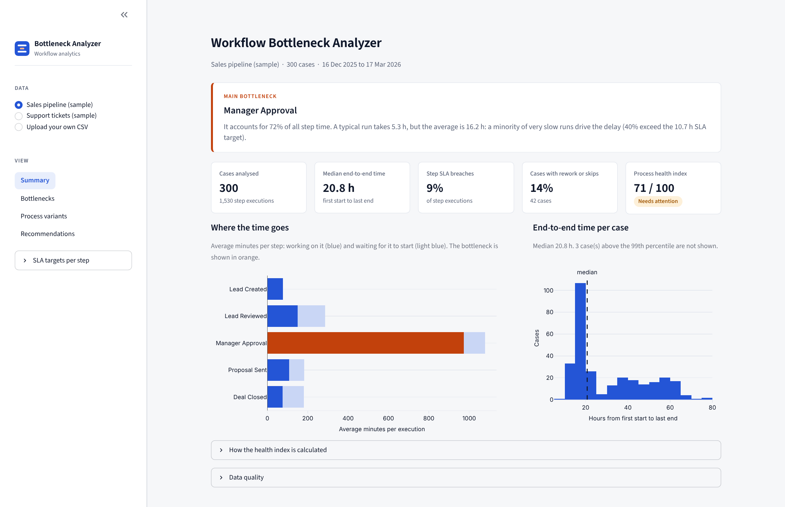
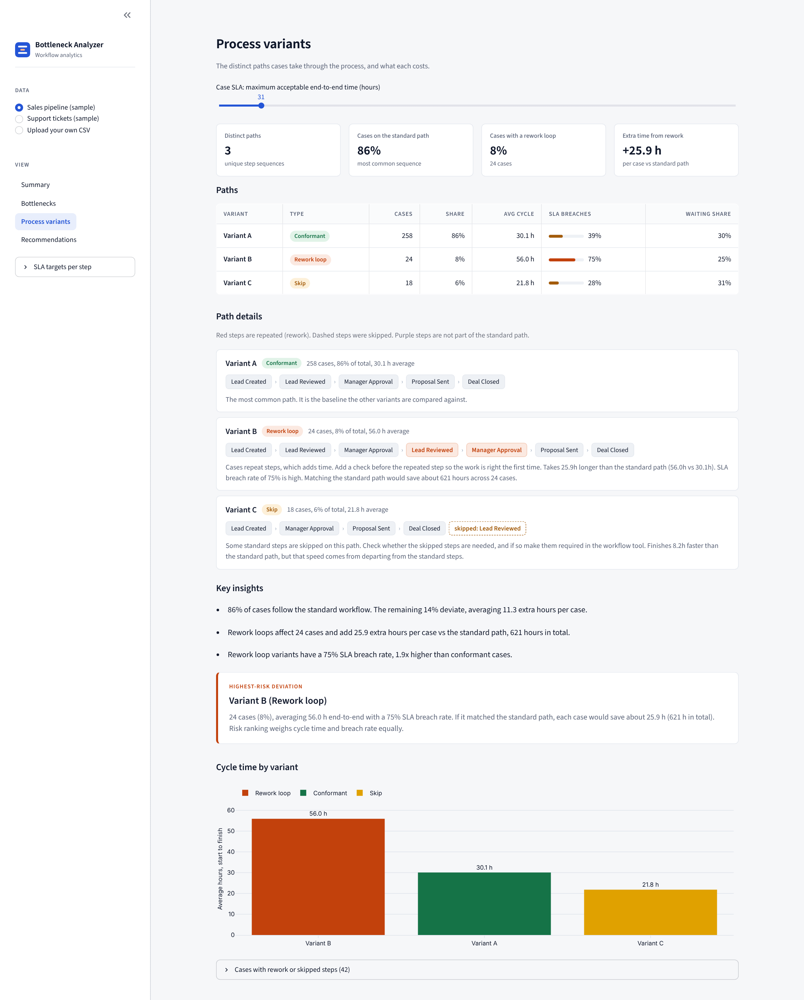
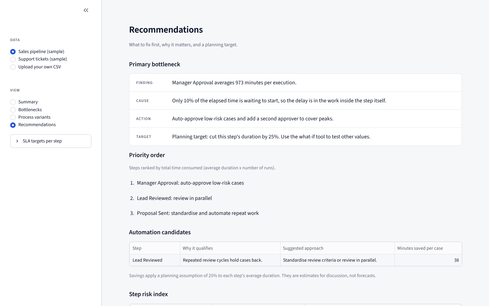

# Workflow Bottleneck Analyzer

Upload an event log from any multi-step process (sales pipeline, support tickets, approvals, onboarding) and see which step slows it down, where cases wait, which paths cost the most, and what fixing the worst step would be worth.



## What it answers

- **Which step is the bottleneck?** Ranked by average duration, with its share of total step time, median vs. average, and SLA breach rate.
- **Where do cases wait?** Time between one step finishing and the next starting, measured per step from the timestamps.
- **Which paths do cases actually take?** Every distinct step sequence, tagged as standard, rework loop or skipped step, with cycle time and SLA breach rate.
- **What is a fix worth?** A what-if control shows the effect of speeding up the bottleneck on end-to-end time.

## Example results (bundled sample data)

| | Sales pipeline (300 cases) | Support tickets (300 cases) |
|---|---|---|
| Bottleneck | Manager Approval, 72% of step time | Investigation, 81% of step time |
| Typical run vs. average | 5.3 h median, 16.2 h average | 2.8 h median, 7.0 h average |
| Longest handoff wait | 2.3 h before Lead Reviewed | 5.3 h before Agent Assigned |
| Cases on the standard path | 86% | 81% |
| Rework loop penalty | +25.9 h per case, 75% breach the case SLA | +12.4 h per case, 56% breach the case SLA |

The sample logs are synthetic and seeded, so these numbers are reproducible: run `python src/generate_dataset.py` to regenerate them.

### Process variants

Every distinct path cases take, compared with the standard path.



### Recommendations

Findings and fixes are derived from the numbers: a slow tail, a queue before a step, rework.



## Run it

```bash
git clone https://github.com/anamika-baruah/workflow-bottleneck-analyzer.git
cd workflow-bottleneck-analyzer
pip install -r requirements.txt
streamlit run dashboard/app.py
```

Python 3.10+. The app opens with a sample dataset loaded; choose **Upload your own CSV** in the sidebar to use your data.

### Input format

| Column | Meaning |
|---|---|
| `case_id` | Identifier of one workflow instance |
| `task` | Step name |
| `start_time` | When the step started |
| `end_time` | When the step finished |
| `user` | Person or system that performed it (optional) |

Your file does not need these exact names. After uploading, the app guesses which column is which (for example `Ticket ID`, `Status`, `Started At`) and a **Match your columns** panel lets you correct it. Day-first dates such as `13/02/2026` are detected automatically.

Step order and SLA targets are not hard-coded. The order is inferred from the data, and SLA targets default to 2x each step's median duration and can be edited in the sidebar.

## How the numbers are calculated

- **Duration** is `end_time - start_time` for a step. **Wait** is the gap between the previous step's end and this step's start in the same case. Nothing is estimated or simulated.
- **Bottleneck** is the step with the highest average duration.
- **Variants** group cases by their exact step sequence. The most common sequence is the standard path; others are tagged rework (a repeated step), skip (a missing step) or extended.
- **Health index** is a heuristic: four measures (SLA breaches 30%, bottleneck concentration 30%, rework 20%, handoff waiting 20%) subtracted from 100. The weights are in `src/health_analyzer.py`.
- **Step risk index** is a weighted ranking (50% average duration, 30% variability, 20% volume). It orders steps; it is not a forecast.
- **Time-saved estimates** apply a stated planning assumption (25% reduction) and are labelled as such in the app.

## Limitations

- Rows whose end time is before the start time, or whose timestamps cannot be parsed, are removed and counted in the Data quality panel.
- Variant mining treats a repeated step as rework and a missing step as a skip, so heavily parallel processes will be over-flagged.
- Default SLA targets are statistical placeholders. Replace them with real targets before drawing conclusions.
- Recommendations come from rules keyed on step names (for example "approval", "review"); unfamiliar names get generic advice.

## Project layout

```
dashboard/    Streamlit app (app.py) and visual theme (theme.py)
src/          Analysis modules: preprocessing, bottleneck detection, variant mining,
              health index, risk ranking, automation candidates, sample data generator
tests/        95 pytest tests
data/         Two sample event logs
.streamlit/   Fixed theme so the app looks the same on every machine
```

Run the tests with `pip install -r requirements-dev.txt` once, then `python -m pytest`.

## Author

Anamika Baruah, final-year MCA student. [GitHub](https://github.com/anamika-baruah)